 

 

---

## About

Information Technology undergraduate at **Universitas Brawijaya**, working toward a career in **software engineering**.

- **Current focus.** Building a solid engineering foundation: understanding the reasoning behind a design, not only the syntax that implements it.
- **Business perspective.** I like looking at a product from both sides, the technology and the value it creates.
- **Rebuilding momentum.** Reviving skills I had left dormant, and the results are beginning to show.
- **Infrastructure background.** Vocational school and an internship gave me a grounding in Linux, networking and cloud, so I write software with an understanding of where it runs.

---

## Tech Stack

**Backend & Web**

**Database & Messaging**

**Cloud, DevOps & Monitoring**

---

## Certifications

- Cisco CCNAv7: Introduction to Networks
- Cisco CCNAv7: Switching, Routing, and Wireless Essentials
- Cisco CCNAv7: Enterprise Networking, Security, and Automation
- Cisco CyberOps Associate
- Computer & Network Engineering: WAN, Server, and VoIP Infrastructure
- Industry Competency Examination: Computer and Network Engineering with Cyber Security Expertise

---

## Activity

<picture>
  <source media="(prefers-color-scheme: dark)" srcset="https://raw.githubusercontent.com/marquisccel/marquisccel/output/github-contribution-grid-snake-dark.svg" />
  <source media="(prefers-color-scheme: light)" srcset="https://raw.githubusercontent.com/marquisccel/marquisccel/output/github-contribution-grid-snake.svg" />
  
</picture>

---

## Contact

Open to internships, graduate roles and collaboration in software engineering.
Reach me on [LinkedIn](https://www.linkedin.com/in/egayurcel) or by [email](mailto:egayurcel990@gmail.com).

